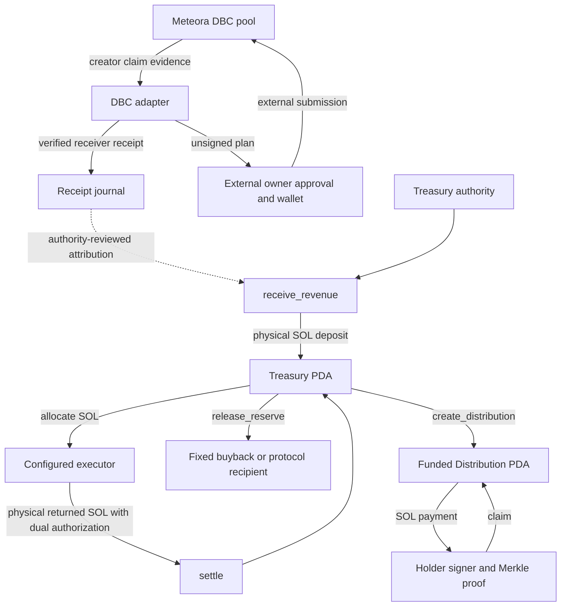

# COMPD — The Compounder

**Built to Compound.**

Solana Mainnet · Meteora Dynamic Bonding Curve · COMPD/SOL

COMPD defines how treasury capital is received, assigned, deployed and reconciled. Its Solana-native source combines an Anchor custody program, integer accounting, a Meteora DBC adapter and an eight-hour Agent lifecycle. Revenue and realized strategy profit follow separate allocation rules; neither a reserve credit nor a market quote is reported as an executed distribution.

Solana Mainnet is the target network. This repository contains source and local validation evidence, not a claim of a completed mainnet deployment, live trading or an independent audit. Implementation boundaries and operational prerequisites are documented alongside the code.

[Architecture](docs/ARCHITECTURE.md) · [Program](docs/PROTOCOL.md) · [Meteora DBC](docs/METEORA-DBC.md) · [Agent](docs/AGENT.md) · [Holder Rewards](docs/HOLDER-REWARDS.md) · [Security](docs/SECURITY.md)

## Protocol overview

The protocol separates four responsibilities:

1. Verify the origin and physical receipt of eligible fees.
2. Account for SOL in strategy, buyback, holder-reward and protocol buckets.
3. Authorize bounded capital movement to configured recipients.
4. Reconcile returned assets and funded holder claims against actual account state.

On-chain custody and off-chain evidence are separate. The treasury authority attests fee attribution when depositing SOL; the Anchor program does not independently verify a Meteora fee claim. The Agent prepares unsigned transactions and verifies external approval without storing signing keys.

## System architecture



The dashed edge carries attribution evidence, not tokens. The creator-fee receiver and Treasury PDA are not assumed to be the same account. An authorized deposit is required to move received SOL into program custody.

## Solana program architecture

The [treasury program](programs/compd-treasury/src/lib.rs) owns four account types:

| Account | Purpose |
|---|---|
| `Treasury` | Authority and immutable identity bindings; liquid buckets, deployed principal, nonces and pause state |
| `Run` | One allocation's treasury binding, principal, identifier and open/closed state |
| `Distribution` | Treasury binding, immutable holder root and remaining funded SOL |
| `Claimed` | Per-distribution/per-index replay marker |

Eight instructions implement the lifecycle: `initialize`, `receive_revenue`, `allocate`, `settle`, `pause`, `release_reserve`, `create_distribution` and `claim`. Treasury, run, distribution and claim addresses use distinct PDA seed domains. The [SDK](packages/sdk/treasury.mjs) derives these addresses explicitly and builds instructions from the [generated IDL](packages/sdk/idl/compd_treasury.json).

## Treasury custody and accounting

Custody is SOL-only. The stored COMPD mint identifies the intended asset; it does not establish a token launch or make the Treasury a general SPL vault.

The four liquid buckets are Strategy Capital, Buyback Reserve, Holder Rewards and Protocol Reserve. Deployed strategy principal is tracked separately from liquid SOL. Each custody-changing treasury instruction checks the required balances and preserves account rent; surplus donations are not automatically classified as revenue.

The [accounting crate](crates/accounting/src/lib.rs) uses checked `u64` balances and `u128` percentage intermediates. The [JavaScript accounting module](packages/sdk/accounting.mjs) uses bounded `BigInt`. No floating-point arithmetic determines allocations.

## Meteora DBC integration

The [DBC adapter](packages/meteora-dbc/index.mjs) uses the official SDK to discover candidate pools and verify a specifically configured pool, creator, config, base mint and SOL quote. Cluster genesis and program-account ownership are checked before preparing supported operations.

Creator claims are quote-only: base-token claims are rejected. Confirmation requires a finalized successful transaction matching the prepared message, the expected claim instruction, one matching event and a reconciling physical SOL receipt. Aggregated vault balances are not treated as per-mint revenue.

[Migration handling](packages/meteora-dbc/migration.mjs) separately supports qualified DBC-to-DAMM-v2 position fees. Both asset receipts remain distinct; mixed fees are not silently booked as SOL revenue. See [Meteora integration](docs/METEORA-DBC.md).

## Agent architecture

The Agent has separate observation, policy, preparation, approval and reconciliation interfaces:

| Module | Responsibility |
|---|---|
| [lifecycle](packages/agent/lifecycle.mjs) | Eight-hour cycle IDs, freshness qualification and risk checks |
| [scheduler](packages/agent/scheduler.mjs) | Abortable cycle scheduling |
| [execution](packages/agent/execution.mjs) | Official DBC quotes, bounded unsigned swaps and buyback/burn preparation |
| [journal](packages/agent/journal.mjs) | Durable receipts, plans, bucket accounting and cycle state |
| [receipts](packages/agent/receipts.mjs) | Confirmed creator-claim processing and external approval verification |
| [custody](packages/agent/custody.mjs) | Ordered program events and treasury balance reconciliation |

The code supplies an autonomous observation scheduler, not an enabled autonomous trader. Strategy execution interfaces require an external orchestrator and owner-authorized wallet submission; neither is installed or activated by this repository.

## Eight-hour lifecycle

Cycle identity is `floor(UTC_epoch_milliseconds / 28_800_000)`. The scheduler attempts the current cycle when started, then waits until the next UTC eight-hour boundary.

SQLite prevents duplicate completed or running cycles. Failed cycles can be retried; interrupted running cycles require explicit operator recovery. Observation records finalized reserve data as unqualified for execution. A separate fresh executable quote is required before strategy policy can accept a transaction plan.

[Agent lifecycle and recovery](docs/AGENT.md) explains these states and their limits.

## Strategy capital management

At allocation time, capital is `strategy + deployed`:

- A single allocation is at most 10% of that capital.
- Aggregate deployed principal is at most 30%.
- At most three runs may remain active.
- A paused treasury rejects new allocations.

Allocation transfers SOL only to the configured executor. Settlement requires both authority and executor signatures, physically returns the declared SOL and closes the run. Returned principal is recovered first; only the excess is profit. A loss pauses new allocations. These limits constrain capital movement, not market losses or executor solvency.

## Protocol revenue allocation

| Destination | Share |
|---|---:|
| Strategy Capital | 35% |
| Buyback Reserve | 15% |
| Protocol Reserve | 50% |

Revenue does not directly fund holder rewards. `receive_revenue` physically deposits SOL from the authority and applies these accounting rules with a sequential receipt nonce.

## Positive realized-profit allocation

| Destination | Share |
|---|---:|
| Strategy Capital | 65% |
| Buyback Reserve | 15% |
| Holder Rewards | 10% |
| Protocol Reserve | 10% |

Profit means returned SOL above a run's recorded principal. Unrealized token gains, quotes and open positions do not qualify. Each percentage division floors to whole lamports; Protocol Reserve receives the remainder so every lamport is accounted for.

## Buyback and burn

A buyback has distinct funding and market-execution steps. `release_reserve` pays the configured buyback recipient; it does not swap or burn tokens.

`prepareDbcExecution` can build a SOL-to-COMPD exact-input swap followed by SPL `BurnChecked`. The burn amount is the quote's protected minimum output; any execution excess remains with the owner for separate handling. Spend limits, at most 100 basis points slippage, fresh quotes, message-bound approval and finalized confirmation protect the prepared path.

There is no automatic reserve-release-to-swap service or proof that a completed swap produced realized strategy profit. See [authorization and settlement boundaries](docs/ARCHITECTURE.md).

## Holder Rewards and Merkle claims

Positive strategy profit credits a reward reserve. The [holder SDK](packages/sdk/holders.mjs) builds a qualified standard-SPL snapshot, aggregates eligible balances by owner and calculates a proportional Merkle allocation.

`create_distribution` moves funded SOL into a separate Distribution PDA. Each leaf binds that distribution, claim index, holder and amount. The holder signs and supplies a valid proof; a unique Claimed PDA prevents the same index being paid twice.

Snapshot eligibility, integer rounding, excluded pool inventory and the 99-token-account limit are explicit in [Holder Rewards](docs/HOLDER-REWARDS.md). Holding tokens does not itself trigger an automatic payment.

## Security and authorization

| Boundary | Implemented control |
|---|---|
| Treasury administration | Authority signer, treasury PDA and `has_one` binding |
| Strategy outflow | Fixed executor, checked limits and unique Run PDA |
| Settlement | Authority plus executor signatures and open-run state |
| Reserve outflow | Configured recipient and checked bucket subtraction |
| Holder payment | Distribution-specific proof, holder signer and claim-index PDA |
| External execution | Unsigned envelope, message/context/expiry-bound approval |
| Reconciliation | Finalized evidence, duplicate/conflict checks and rent-backed accounting |

The authority remains privileged: attribution and holder-root correctness rely on reviewed off-chain evidence. Pause stops new allocation, not every instruction. There is no claim that these controls replace an independent audit.

The retained [dependency review](docs/DEPENDENCY-SECURITY.md) discloses all 14 affected package entries. Publishing source with disclosure is separate from approving mainnet operation. Report vulnerabilities according to [SECURITY.md](SECURITY.md).

## Repository structure

```text
programs/compd-treasury/   Anchor SOL custody and holder claims
crates/accounting/        Integer ledger, allocation and settlement rules
packages/agent/          Observation, policy, preparation and journals
packages/meteora-dbc/    Official DBC and qualified DAMM v2 adapters
packages/sdk/            Accounting, PDAs, IDL and holder tooling
tests/                   Offline Node regression tests
scripts/                 Syntax/safety check and prior local tool setup
docs/                    Technical references and legal evidence
Anchor.toml              Localnet program/build configuration
Cargo.toml               Rust workspace
package.json             Node commands and pinned dependencies
```

No website, private runtime state, generated keypair or historical implementation commits are included.

## Technology stack

| Layer | Actual implementation |
|---|---|
| Program and accounting | Rust, Anchor 0.31.1 |
| Agent and SDK wrappers | JavaScript ES modules (`.mjs`), Node.js 24+ |
| Solana clients | web3.js 1.98.4, SPL Token 0.4.15, Anchor client 0.31.1 |
| Meteora clients | DBC SDK 2.0.0, DAMM v2 SDK 1.5.1 |
| Local persistence | Node built-in SQLite with WAL and transactional receipts |
| Integer SDK boundary | `bn.js` 5.2.5; internal lamport arithmetic uses `BigInt` |

The client libraries expose TypeScript interfaces upstream; this repository does not currently contain a first-party TypeScript implementation or a Rust Agent. [Dependency provenance](docs/DEPENDENCIES.md) records pinned references.

## Local build and tests

Install Node.js 24+, Rust/Cargo, Anchor CLI 0.31.1 and the compatible Solana SBF tooling. The validated source checkpoint used Rust 1.89.0, Agave 4.3.2 and SBF platform-tools 1.57.

```sh
npm ci --ignore-scripts
npm run check
npm test
cargo check --workspace
cargo test --workspace
anchor build
```

The earlier source checkout passed six Rust tests, 29 Node tests and SBF/IDL generation. These are retained checkpoint results, not claims that the clean repository includes installed tools or has run against a validator. The ignored `.tooling/` directory and development key files are deliberately absent. [Build prerequisites](docs/PROTOCOL.md#local-build-and-validation) explain setup and the existing development ID without requesting key regeneration or deployment.

`npm run agent` invokes a single observation CLI when given owner-verified public inputs; it does not start the scheduler or trading. Do not run mainnet operations as part of contributor tests.

## Technical documentation

| Document | Coverage |
|---|---|
| [Architecture](docs/ARCHITECTURE.md) | Components, trust boundaries, lifecycle diagrams and recovery |
| [Program reference](docs/PROTOCOL.md) | All instructions, accounts, constraints, errors and economics |
| [Meteora DBC](docs/METEORA-DBC.md) | Discovery, fee attribution, unsigned claims and migration |
| [Agent](docs/AGENT.md) | Scheduling, policy, authorization, journaling and recovery |
| [Holder Rewards](docs/HOLDER-REWARDS.md) | Snapshots, Merkle proofs, funding and reconciliation |
| [Security architecture](docs/SECURITY.md) | Authority, custody, replay, dependency exposure and reporting |
| [Dependency findings](docs/DEPENDENCY-SECURITY.md) | All 14 affected entries, mitigations and remaining risk |
| [Operational gates](docs/BLOCKERS.md) | Mainnet inputs, verification scope and bounded interfaces |
| [Publication scope](docs/PUBLICATION-TREE.md) | Clean-history source and publication approvals |

## Contributing

Contributions should identify a reproducible problem and make the smallest useful change. Review the source and [contribution guide](CONTRIBUTING.md), preserve financial rules and authorization, and include tests appropriate to the behavior changed. Do not introduce keys, runtime databases, fabricated chain evidence or deployment steps.

## License and attribution

Original COMPD-owned source code is MIT licensed under `Copyright (c) 2026 CompdProtocol`. [LICENSE](LICENSE) and [LICENSE-SCOPE.md](LICENSE-SCOPE.md) define the grant and exclusions. Standalone documentation, artwork and third-party work are not automatically covered by that grant.

[THIRD_PARTY_NOTICES.md](THIRD_PARTY_NOTICES.md) and the exact notices under `docs/legal/` remain applicable. This repository does not claim ownership of Meteora, Solana, Anchor or any other third-party implementation.
