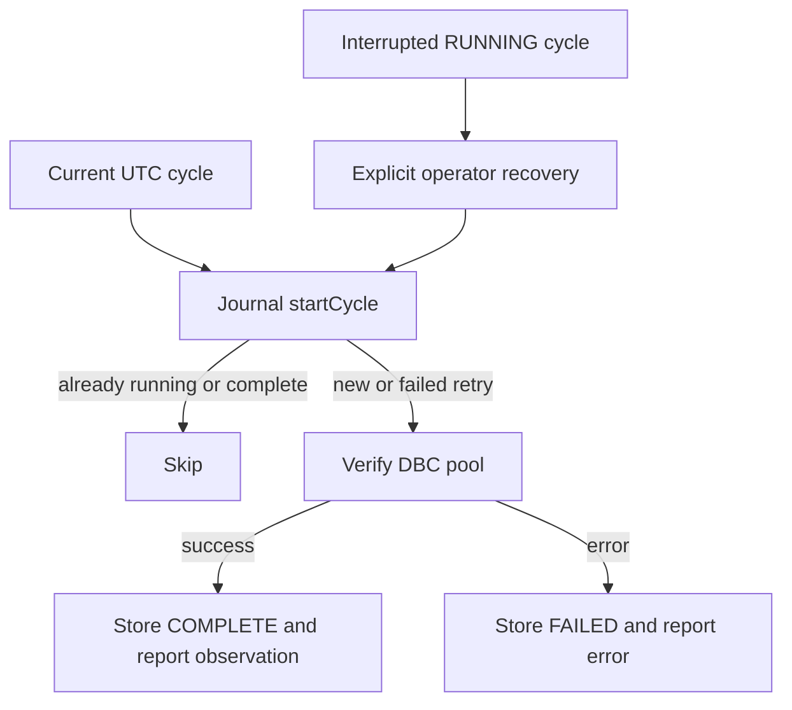

# Solana Agent

[README](../README.md) · [Architecture](ARCHITECTURE.md) · [Meteora](METEORA-DBC.md) · [Security](SECURITY.md)

## Modules and actual execution boundary

| Source | Implemented responsibility |
|---|---|
| [cli.mjs](../packages/agent/cli.mjs) | One observation cycle using owner-supplied public configuration |
| [scheduler.mjs](../packages/agent/scheduler.mjs) | Abortable repeated observation at eight-hour boundaries |
| [lifecycle.mjs](../packages/agent/lifecycle.mjs) | Cycle ID, freshness and strategy risk policy |
| [execution.mjs](../packages/agent/execution.mjs) | Executable quote, bounded unsigned swaps/burns, approval and confirmation |
| [journal.mjs](../packages/agent/journal.mjs) | SQLite receipts, buckets, cycles and prepared plans |
| [receipts.mjs](../packages/agent/receipts.mjs) | Verified claim ingestion and approval-verification interface |
| [custody.mjs](../packages/agent/custody.mjs) | Finalized program-event ingestion and custody-state reconciliation |

These are composable interfaces, not an enabled trading service. The scheduler observes; no scheduler-to-trade decision loop, signing wallet or broadcast client is wired in. No model-driven strategy, market-prediction engine or profitability claim is supplied.

## Eight-hour scheduling

`CYCLE_MS = 8 * 60 * 60 * 1000`. `cycleAt` floors a safe nonnegative UTC epoch timestamp to that interval. Boundaries are 00:00, 08:00 and 16:00 UTC. The scheduler attempts the current cycle immediately on startup, then waits to the next boundary; it is not a catch-up engine for every missed historical interval.

`Journal.startCycle` locks via `BEGIN IMMEDIATE`. COMPLETE or RUNNING IDs skip, FAILED IDs may restart. Successful observation marks COMPLETE; exceptions mark FAILED and propagate to the scheduler's report callback. Abort signals stop the wait/loop. `recoverCycle` explicitly marks a RUNNING cycle FAILED; operators must establish that no live worker owns it before retrying.

## Observation and market qualification

`cycle` validates the configured DBC pool and reports finalized base/quote reserves with `verified=false`. A reserve ratio is not an executable trade quote. `qualifyMarket` requires a positive `BigInt` price, explicitly verified sample, safe observation timestamp and freshness (60 seconds by default); future/stale samples reject.

`quoteMarket` calls the official exact-input quote interface using verified pool/config, current activation point, amount and slippage. It derives a positive protected minimum and integer quote price. DBC fees, liquidity and state may change after quoting; finalized-message confirmation is still required.

## Strategy policy and capital controls

`prepareTreasuryStrategy` derives/fetches the real Treasury, verifies authority/executor identity and supplies `strategy + deployed`, deployed principal, active runs and paused state to policy evaluation. Caller limits still determine admitted pools/mints and maximum spend.

Strategy preparation requires positive bounded spend, enough available capital, pool/mint allowlists, no pause, fewer than three active runs, at most 10% capital per run, at most 30% aggregate deployment and slippage between 0 and 100 basis points. On-chain allocation independently enforces its ledger limits; a prepared swap alone does not allocate treasury funds or create a run.

The buyback path uses spend/slippage bounds and permits only SOL-to-configured-COMPD direction. It does not invoke every strategy-only admission check. Owners must separately authorize the reserve funding and buyback policy; do not describe it as inheriting all strategy checks.

## Transaction preparation and approval

`prepareEnvelope` rejects already signed inputs, records required signer public keys and serializes an unsigned transaction. The message hash is SHA-256 of the serialized message. Approval commits to `COMPD_APPROVAL_V2`, that hash, canonical context hash and last-valid block height.

`verifyApproval` verifies an externally supplied Ed25519 signature; it does not generate one. `authorizeExecution` additionally binds allowed owner, maximum spend and a quote observation no older than 60 seconds. An approval is not a Solana transaction signature. Changing blockhash, accounts, instruction bytes or context requires fresh approval and policy review.

`confirmExecution` requires a successful finalized legacy transaction whose message exactly equals the prepared message. It confirms swap/burn message success, not economic profit or Treasury settlement. The external wallet and operational submitter remain integration requirements.

## Receipt journaling and replay protection

SQLite uses WAL and synchronous FULL. Receipt signatures are primary keys; amounts are decimal strings converted to bounded `BigInt`. Insertion and 35/15/0/50 receiver-bucket credit occur in one transaction. Matching duplicates return false; any differing pool/mint/receiver/slot/amount conflicts and rolls back.

`recordPlan` persists an envelope keyed by message hash in PREPARED state. The journal does not implement a complete approved/submitted/finalized plan state machine or automatically replay interrupted transfers. `Journal.reconcile` compares receipt-bucket totals with a caller-supplied reconciled unspent amount; it is not itself an RPC balance fetch or Treasury PDA audit.

## Custody reconciliation and recovery

`finalizedCustodyEvents` binds a finalized successful transaction to its prepared message, checks the IDL program identity and decodes actual program log events for the expected Treasury. `CustodyJournal.apply` enforces a contiguous per-treasury sequence starting at zero; matching duplicates are idempotent and conflicts/gaps fail.

`reconcileCustody` checks program account ownership, authority-derived PDA, event nonce, bucket balances, deployed principal and rent-backed solvency. Extra lamports are returned as unclassified, not credited to revenue. Initialization/pause and holder-claim events are not part of the Custody sequence; claim reconciliation is separate.

Recovery requires backfilling missing finalized evidence before accepting new custody events. Receipt conflicts, unexpected rent effects, missing SDK events and unsafe RPC precision are review conditions. Do not fabricate replacement receipts or steal RUNNING cycle locks to make processing continue.

## Local operation and remaining integration

The actual script is `npm run agent -- observe <public-inputs-file>`; CLI fields are HTTPS `rpcUrl`, independently verified `genesisHash`, `mint`, `creator`, `pool`, `config`, `receiver`, `payer` and a private local `journalPath`. No example invents a COMPD mint or a signer. This command is documented, not executed against mainnet here.

An owner-controlled process would have to connect the scheduler, strategy selection, authority review, external wallet, confirmation, deposits, settlement and restart policies. Signing and broadcasting remain absent by design. The [14 dependency entries](DEPENDENCY-SECURITY.md), unsupported migration forms and [operational limits](BLOCKERS.md) remain open independently of publishing this source.
