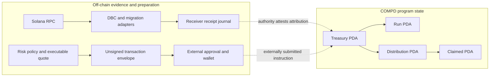
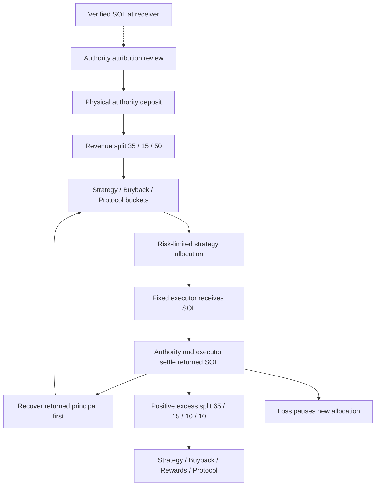
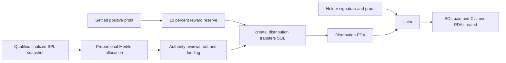

# Architecture

[README](../README.md) · [Program](PROTOCOL.md) · [Meteora](METEORA-DBC.md) · [Agent](AGENT.md) · [Rewards](HOLDER-REWARDS.md) · [Security](SECURITY.md)

## Components and responsibilities

| Component | Source | Responsibility |
|---|---|---|
| Treasury program | [lib.rs](../programs/compd-treasury/src/lib.rs) | SOL custody, account authorization, bucket updates, run settlement and funded claims |
| Accounting crate | [lib.rs](../crates/accounting/src/lib.rs) | Checked balances, allocation caps, principal recovery and profit split |
| Treasury SDK | [treasury.mjs](../packages/sdk/treasury.mjs) | PDA derivation and generated-IDL unsigned instruction builders |
| DBC adapter | [index.mjs](../packages/meteora-dbc/index.mjs) | Cluster/pool/mint validation, supported claim preparation and receipt evidence |
| Migration adapter | [migration.mjs](../packages/meteora-dbc/migration.mjs) | Qualified DAMM v2 position claims and per-asset confirmation |
| Execution interface | [execution.mjs](../packages/agent/execution.mjs) | Fresh quote, policy checks, unsigned swap/burn and external approval |
| Agent journals | [journal.mjs](../packages/agent/journal.mjs), [custody.mjs](../packages/agent/custody.mjs) | Receipt idempotency, cycle recovery and program-custody reconciliation |
| Holder tooling | [holders.mjs](../packages/sdk/holders.mjs) | Qualified snapshots, proportional Merkle allocations and funded-claim checks |

## On-chain and off-chain boundary

The RPC is a source of evidence, not a trusted substitute for program checks. These off-chain reads are not generally a single atomic bank snapshot; the holder path explicitly requests a single-bank batch and reconciles supply. External submission, wallet custody and ongoing service orchestration are outside these modules.

## Accounts and authorities

`Treasury` is derived from the authority public key. Its authority, COMPD mint identity, executor and reserve recipients are set by `initialize`; there is no rotation instruction. Fixed identities must be reviewed before initialization.

A run belongs to a treasury. Allocation requires the authority and pays only the stored executor. Settlement requires both authority and executor; `Run.open` prevents a second settlement. Distributions are funded from the treasury reward bucket and hold their own SOL. Holders prove a leaf and sign for their own payout; they do not require treasury-authority approval for an existing valid claim.

The authority chooses deposit attribution and reward roots. The program proves authorized custody operations and Merkle membership, not that an off-chain fee classification or holder snapshot was economically correct.

## Treasury accounting flow

The revenue journal is not the program ledger: `Journal.receipt` credits receiver-side accounting, while `receive_revenue` physically transfers SOL from the authority into the Treasury. No service automatically bridges these stages. `deployed` represents outstanding principal outside treasury custody and is excluded from the sum of liquid buckets.

## Agent decisions and execution

Observation runs on eight-hour UTC cycle identities. `cycle` validates the configured pool and records reserve observations; it deliberately labels them unqualified for execution. `quoteMarket` obtains an official exact-input quote and a positive minimum output. `prepareTreasuryStrategy` reads treasury state, checks authority/executor identity and constructs policy from real balances.

Strategy admission, spend cap, capital exposure, active runs, pause, quote age and slippage must pass before unsigned preparation. `authorizeExecution` verifies externally supplied approval of the exact message, canonical context and expiry. The external wallet is still responsible for signing/submission; `confirmExecution` later verifies a finalized identical legacy message. This proves message success, not profit or a subsequent treasury settlement.

The scheduler does not invoke the strategy planner, buyback planner or transaction broadcaster. A full policy-to-wallet-to-settlement orchestrator remains an integration requirement.

## Buyback funding and settlement

`release_reserve` debits Buyback Reserve and pays its fixed recipient. Independently, `prepareDbcExecution(kind='buyback')` prepares an exact-input SOL-to-COMPD swap and checked burn of the protected minimum output. More output than the minimum is not automatically burned.

There is no on-chain linkage proving that a reserve release funded a specific external swap. The burn path confirms its approved message; strategy-profit settlement remains a distinct authority/executor SOL-return instruction. A buyback expense is not strategy profit.

## Holder Rewards lifecycle

A root is immutable after creation; a claim is tied to that distribution, index, holder and amount. Funding and claims do not query current token balances. Snapshot eligibility is historical off-chain evidence, not automatically established by the program. See [reward construction and limits](HOLDER-REWARDS.md).

## Error handling and recovery

On-chain failures roll back the whole instruction/transaction, including newly initialized claim/run accounts and transfers. Checked arithmetic, signer/PDA constraints, rent retention and proof verification reject invalid transitions.

Off-chain receipt insertion and bucket updates use SQLite transactions. A duplicate signature with matching evidence is a no-op; conflicting evidence fails. Custody events require contiguous per-treasury sequence numbers, exact finalized-message binding and matching decoded account state. Missing history requires backfill, not guessed bucket balances.

Interrupted cycles remain RUNNING until explicitly recovered. Unexpected receipt rent effects, unsafe RPC number precision, missing events, unsupported migration proofs or snapshot scale reject processing. A changed blockhash/message requires a new approval.

## Validation scope

The source checkpoint passed six Rust and 29 Node tests and an Anchor SBF/IDL build. Native dispatch tests do not execute every instruction in an SBF VM. The clean publication tree has no installed development toolchain, private key or configured mainnet deployment. [Operational gates](BLOCKERS.md) and [dependency risk](DEPENDENCY-SECURITY.md) remain separate from source-distribution approval.
