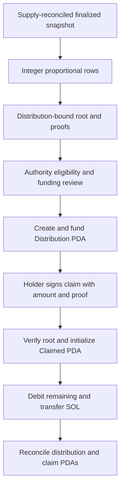

# Holder Rewards and Merkle claims

[README](../README.md) · [Architecture](ARCHITECTURE.md) · [Program](PROTOCOL.md) · [Security](SECURITY.md)

Sources: [holder tooling](../packages/sdk/holders.mjs), [leaf/PDA builders](../packages/sdk/treasury.mjs), [Anchor claim and distribution code](../programs/compd-treasury/src/lib.rs).

## Funding source and accounting

Only positive realized strategy profit credits Holder Rewards: 10% after principal recovery, subject to integer rounding. Protocol revenue has a 0% direct holder allocation. An accounting reserve is not a payment; the authority must create and fund a distribution before holders can claim SOL.

`create_distribution` subtracts its positive funded amount from Treasury.rewards and physically moves SOL to a newly initialized Distribution PDA. The authority pays rent separately. Root, treasury binding and remaining funding are stored on-chain. There is no root-update, cancellation, expiry or distribution-close instruction.

## Snapshot generation

`snapshotFromVerifiedPool` first verifies the configured active DBC pool and obtains its base vault. `holderSnapshot` requires that vault be explicitly listed among excluded token accounts. It does not guess other exclusions or owner eligibility policy.

Discovery uses standard SPL Token program accounts filtered to the COMPD mint and 165-byte layout. At most 99 discovered token accounts are admitted. Mint and all discovered accounts are fetched together in a finalized bank at or after the discovery slot; missing accounts or changed identities fail.

The mint must be initialized with mint/freeze authorities disabled. Decoded token accounts must be initialized and match the mint. `qualifySnapshot` rejects duplicate accounts and requires the sum of all discovered balances, including excluded balances, to equal the mint supply. This supply check rejects incomplete discovery rather than silently allocating from a partial holder set.

Eligible balances are aggregated by owner, with these exclusions:

- Explicitly excluded token-account addresses, including pool inventory.
- Frozen token accounts.
- Off-curve owner public keys.
- Zero aggregated eligible balances.

Owners are sorted lexicographically by public-key string. An exclusion list is an account list, not an automatic owner blacklist. Off-curve exclusion means program-controlled holders are not entitled under the current implementation; this is a policy boundary requiring owner review, not a universal eligibility definition.

## Allocation and Merkle construction

`rewardTree(snapshot, distribution, budget)` uses integer proportional allocation:

```text
holder_amount = floor(budget * eligible_owner_balance / total_eligible_balance)
funded = sum(nonzero holder_amounts)
remainder = budget - funded
```

Zero-rounded rows are removed; remaining rows receive consecutive indices. Fund exactly `tree.funded` when creating the distribution to match the generated claim set. The rounding remainder need not leave the Treasury reward reserve; this function does not reallocate it to a holder or automatically fund it.

Each SHA-256 leaf commits to the concatenation:

```text
COMPD_HOLDER_V1
32-byte distribution public key
8-byte little-endian claim index
32-byte holder public key
8-byte little-endian lamport amount
```

Parent nodes hash the two children sorted by raw byte order. An unpaired node is promoted to the next level unchanged. The output contains root, funded amount, remainder, snapshot slot/mint, per-holder proofs and a serialized-snapshot hash. Proof construction and on-chain verification use the same [hash helpers](../packages/sdk/treasury.mjs).

## Distribution and claim lifecycle



The authority must derive the intended distribution address before building leaves. It then submits that root using the next distribution ID. Each holder supplies the exact index/amount/proof and signs as the committed recipient. The holder also pays rent for the claim marker.

`claim` permits at most 32 sibling nodes and a positive amount. A leaf is bound to one distribution and holder; a valid proof for another address or distribution fails. Initializing the same `(distribution,index)` Claimed PDA twice is rejected by Anchor. If proof, balance or rent validation fails, transaction rollback prevents consuming the claim marker without its payment.

The program checks Merkle membership and funded remaining balance. It does not inspect the current token account, re-evaluate snapshot balances, enforce unique holder rows in an authority-provided tree or independently prove the source snapshot. Root correctness remains an authority trust boundary.

## Funded reward reconciliation

`reconcileFundedRewards` reads the Distribution and all expected claim PDAs in one finalized bank, verifies program ownership, decodes typed accounts and binds the distribution's treasury. Existing valid claim markers supply payment evidence for their expected rows; invented caller payment history is not used by this RPC wrapper.

`reconcileRewards` verifies root, unique paid indices, exact row owner/amount, remaining accounting and `actualLamports = rent + remaining`. An unexpected donation or other surplus fails exact distribution reconciliation even though the on-chain rent floor can remain solvent. Review such discrepancies; do not manufacture claim evidence.

## Limits and remaining integration

Snapshot generation permits 99 token accounts plus mint in its atomic batch. Funded reconciliation separately permits 99 claim rows plus distribution. Larger sets fail and require a separately reviewed atomic snapshot/reconciliation design; pagination is not presented as equivalent evidence.

No public proof-hosting service, claim website, continuous indexer, automatic root publisher or payout scheduler is included. This source provides the snapshot, tree, instruction builders and funded accounting interfaces. Node tests exercise deterministic proof/accounting cases; a full validator reward lifecycle and operational eligibility review remain [mainnet gates](BLOCKERS.md).
