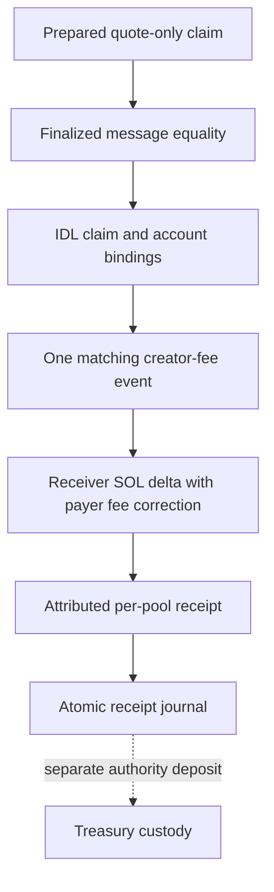

# Meteora DBC integration

[README](../README.md) · [Architecture](ARCHITECTURE.md) · [Agent](AGENT.md) · [Security](SECURITY.md)

Implementation: [DBC adapter](../packages/meteora-dbc/index.mjs), [migration adapter](../packages/meteora-dbc/migration.mjs), [execution preparation](../packages/agent/execution.mjs). Pinned official SDK versions and upstream references are in [DEPENDENCIES.md](DEPENDENCIES.md); the code uses SDK program IDs and IDL coders rather than invented offsets or instruction layouts.

## Supported boundary

The target is a configured standard-SPL COMPD base mint with wrapped SOL (`NATIVE_MINT`) quote. Active DBC creator claims support quote fees only. Transfer-hook pools, enabled mint/freeze authority and migration transitions are not admitted by the standard path. Post-migration position fees use a separate qualified DAMM v2 interface.

No token launch, configured COMPD mainnet pool or live fee collection is implied. This adapter does not create a coin, determine launch economics or automatically select a pool for execution.

## Inputs, discovery and identity

`Dbc` requires `mint`, `creator`, `pool`, `config`, `receiver`, `payer` and an independently verified `genesisHash`. `Dbc.connect` additionally requires an HTTPS RPC URL. Public-key syntax is checked, but that alone does not establish authority or economic ownership.

`discover()` calls `client.state.getPoolsByCreator` and filters base mint. It returns candidate addresses; each candidate must still be reviewed and explicitly configured. `verify()` then checks:

1. RPC genesis hash matches the expected cluster.
2. Pool and config accounts are owned by the SDK's DBC program ID.
3. The pool is not a transfer-hook pool.
4. Decoded base mint, creator and config match expected identities.
5. Quote mint is wrapped SOL and creator trading-fee percentage is positive.
6. Standard-SPL mint/freeze authorities are disabled.
7. `isMigrated` and `migrationProgress` are both zero.

Reads are finalized but span multiple calls, not a single locked bank. Revalidation and actual transaction execution constraints remain separate safeguards. A configured creator field is not itself proof of wallet control; the official instruction defines required signers, and the envelope exposes them.

## Creator-fee preparation

`prepareClaim()` uses `creator.claimCreatorTradingFeeToReceiver` with `maxBaseAmount=0` and the verified `creatorQuoteFee` as maximum quote amount. It rejects zero available quote fees, assigns fee payer/blockhash, checks a network-fee estimate and payer balance, and requests unsigned simulation. Simulation addresses additional account/rent failures; a fee estimate alone is not proof of sufficient rent funding.

The result is an unsigned envelope with required signers, message hash, context and last-valid block height. Owner approval is verified separately; no adapter method signs or broadcasts. These simulation code paths exist but have not been qualified with live COMPD mainnet inputs.

## Attribution and finalized receipt

`confirmedReceipt()` revalidates context and pool state, fetches a successful finalized legacy transaction and compares its serialized message to the plan. `validateClaimInstruction()` requires exactly one DBC instruction decoded as `claimCreatorTradingFee`, quote-only parameters and the IDL-defined pool/creator/base/quote account bindings.

Event decoding examines DBC inner instructions with Anchor's event-CPI prefix and decodes `evtClaimCreatorTradingFee` using the SDK coder. `uniqueClaim` requires exactly one matching pool event, zero base amount and positive quote amount.

Physical receipt is `receiver postBalance - preBalance`, plus transaction fee only when that receiver is the fee payer. Safe-integer RPC balances are required, and the adjusted delta must equal the event quote amount. Rent/refund/other unexplained effects fail for review rather than being inferred as revenue. An aggregate creator-vault balance never establishes COMPD-specific income.

`recordConfirmedClaim` writes only this receipt to the receiver-side journal. It does not call `receive_revenue` or prove custody in the COMPD program; that requires a separate authorized SOL deposit and custody reconciliation.

## Graduation and migration

The standard adapter suspends claims whenever the decoded pool is migrating or migrated. It does not infer completion from a reserve threshold or label a pool graduated solely from market observations.

`prepareMigratedPositionFees` requires a finalized successful legacy migration transaction containing exactly one decoded `migrationDammV2` instruction. `migrationBinding` binds the original virtual pool/config, DAMM pool and one of the first/second position accounts exposed by the official IDL.

It also verifies DBC ownership/state, DAMM pool/position program ownership, position-to-pool binding, COMPD/SOL mint pair, disabled COMPD mint/freeze authority, and current Token-2022 position NFT ownership. The NFT must hold one token, have no delegate and not be frozen. This NFT check is distinct from support for a Token-2022 COMPD base asset, which the implementation does not provide.

The official DAMM `claimPositionFee` builder prepares an unsigned claim and simulation. The owner, receiver and payer remain explicit. No code assumes that a configured DBC creator owns every migrated position.

## DAMM v2 fee confirmation

`confirmMigratedPositionFees` verifies exact finalized legacy-message equality, decodes one matching `evtClaimPositionFee`, binds pool/position/owner and reconciles both asset amounts independently. SOL uses physical balance/fee correction; SPL receipts use receiver-owner/mint token-balance deltas.

The result contains separate `assets` and `solOnly=false`. It is not passed automatically through SOL revenue allocation. Token conversion, owner decisions and any subsequent treasury deposit are separate work. The confirmation path accesses the pinned SDK's `_program` event coder, an internal interface that needs compatibility review on SDK upgrades.

## Explicit limitations and validation

DAMM v1, unsupported/v0 migration proofs, unproven position ownership and ambiguous events fail closed. Active-DBC swap/buyback preparation is not a migrated-pool trading router. No live COMPD migration transaction or funded position is configured.

Tests inspect installed SDK interfaces/IDL and synthetic transaction evidence; they are not evidence that a COMPD pool has launched. [Dependency findings](DEPENDENCY-SECURITY.md) remain applicable to both official SDKs. Follow [operational gates](BLOCKERS.md) before any mainnet action.
